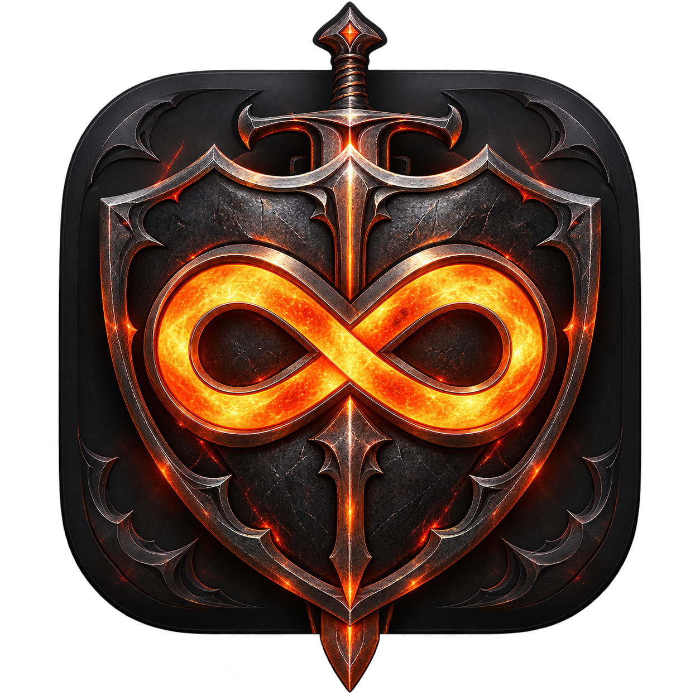

# Crimson Desert Trainer



[](https://github.com/darkuser89/Crimson-Desert-Mac-Trainer-/actions/workflows/build-release.yml)

[**Aktuelle App herunterladen**](https://github.com/darkuser89/Crimson-Desert-Mac-Trainer-/releases/latest)
· [Alle Releases](https://github.com/darkuser89/Crimson-Desert-Mac-Trainer-/releases)

Nativer macOS-Trainer aus mactrainertemplate. Die Originalvorlage wird nicht verändert.
Unterstützt wird genau die Steam-arm64-Ausgabe mit Spielversion **2.04.03**,
Bundle-Version **1.0.35 (433)** und Executable-UUID
`0D6EC6AE-D229-3D5B-BEB9-9DD74EF820DA`. Andere Builds bleiben gesperrt.

## Bedienung

1. Steam öffnen, eine bereits laufende Spielinstanz regulär beenden.
2. „Crimson Desert Trainer.app“ öffnen und „Spiel mit Trainer starten“ wählen.
   Falls nötig vorher die installierte Spiele-App auswählen.
3. Einen vorhandenen Spielstand laden. Das Overlay startet verborgen.
4. **⌘ + ^** öffnet/schließt das Overlay mit freier Maus. Alternativ im Launcher
   **„Overlay einblenden“** wählen. **Esc** oder das × im Panel schließt es.

| Taste | Funktion |
| --- | --- |
| F1 | Unbegrenztes Leben |
| F2 | Maximales Leben setzen |
| F3 | Unbegrenzte Ausdauer |
| F4 | Maximale Ausdauer setzen |
| F5 | Unbegrenzter Geist |
| F6 | Maximalen Geist setzen |
| F7 | Verteidigung setzen |
| F8 | Menge des ausgewählten Inventarstapels setzen |
| F9 | Spieltempo |
| F10 | Superschaden (Angriff 10.000) |
| F11 | Tageszeit anhalten |
| F12 | Tageszeit einmal um eine Stunde vorsetzen |
| ⌘F8 | Geld setzen, in kleinsten Einheiten (100 = 1,00 Anzeige) |
| ⇧F9 | Alle Schalter aus |

Je nach macOS-Einstellung benötigen die Funktionstasten zusätzlich Fn.
Zahlen im Overlay anklicken, eingeben und mit Enter übernehmen; den zugehörigen
Schalter bzw. „GO“ danach betätigen. Grün bestätigt den zurückgelesenen Effekt.
Die Gegenstandsaktion benötigt das offene Spielinventar mit einem ausgewählten
Stapel. Geld ist eine getrennte Aktion; es gibt keinen automatischen Ersatz
für einen fehlenden ausgewählten Gegenstand. Stapellimits des Spiels gelten.
Geld und Gegenstände sowie die vorgestellte Tageszeit kann das Spiel speichern.
⇧F9 nimmt Schaltereffekte zurück; bereits ausgeführte Einmalaktionen bleiben bestehen.

„Cheat-Auswahl beim nächsten Start laden“ merkt Schalter und Zahlen pro Profil.
Der erweiterte Katalog verwendet eine neue Profilkennung, damit alte
Auffüll-Schalter keine anderen Cheats aktivieren. Einmalaktionen werden nie
wiederhergestellt. Während des Ladens bleibt die Auswahl erhalten; Wirkungen
werden erst an gültige lokale Besitzer gebunden.
Der Demo-Knopf öffnet weiterhin sechs klar gekennzeichnete Simulationen ohne Spielanbindung.

## Bauen

```sh
./script/build_and_run.sh --build-only
./script/build_and_run.sh run
```

Apple Silicon, Xcode26+ mit macOS26+-SDK und Python3 erforderlich.
Standardziel ist der separate Nachbarordner `../CrimsonDesertTrainer-Build`.
Mit `MT_TRAINER_BUILD_DIR` kann ein anderer externer stabiler Buildordner gewählt
werden. Das Skript testet vor dem Austausch und behält nur die aktuelle App.
GUI-Tests benötigen eine macOS-Grafiksitzung. Zielsystem ab macOS14;
macOS14/15 wurden nicht auf echten Geräten getestet. Lokal ad hoc signiert,
keine Apple-Notarisierung.

## Automatische Builds und Releases

GitHub Actions baut und testet jeden Push auf `main` sowie Pull Requests auf
einem nativen Apple-Silicon-Runner mit macOS26. Der geprüfte ZIP-Build ist sieben
Tage als Workflow-Artefakt verfügbar. Unter „Actions“ lässt sich derselbe Ablauf
auch manuell starten. Spieltests gehören nicht zum CI-Lauf.

Ein Versions-Tag wie `v0.2.0` baut dieselbe App und veröffentlicht nach allen
Prüfungen automatisch einen GitHub-Release mit ZIP, Installationshinweisen und
SHA-256-Prüfsummen. Das Tag muss zur Version in `Resources/TrainerConfig.json`
passen. Für eine neue Version App-Version und Buildnummer aktualisieren,
Release-Notizen in `docs/RELEASE_NOTES.md` anpassen, committen und dann taggen:

```sh
git push origin main
git tag -a v0.2.0 -m "Crimson Desert Trainer v0.2.0"
git push origin v0.2.0
```

Das Workflow-Publishing verwendet ausschließlich den kurzlebigen `GITHUB_TOKEN`;
zusätzliche Repository-Secrets sind nicht erforderlich. Nur der Release-Job darf
Releases schreiben. Die verwendeten GitHub-Actions sind auf Commit-IDs fixiert.

Ein lokales Release-Paket lässt sich nach dem Build außerhalb des Codes erzeugen:

```sh
python3 -B script/package_release.py ../CrimsonDesertTrainer-Build/Release --tag v0.2.0
```

Die Verpackung prüft Architektur, App-Metadaten und Signatur, entpackt das ZIP
kurzzeitig und prüft die enthaltene App erneut. Pro Ausgabeordner werden dieselben
Dateinamen wiederverwendet. Der Quellcode enthält keine Apps, Buildbäume oder Saves.

## Native Anbindung

`CrimsonNative.mm` prüft UUID und Instruktionsanfänge, bevor spielinterne Funktionen
aufgerufen werden. Native One-Shot-Timer liefern Arbeit auf den tatsächlichen
`GameThread`. Lokale Actor-Scope-Attacher schützen den Spieler während eines
Aufrufs. Aktueller Besitzer, Gebiet und Ladezustand werden vor Änderungen geprüft.
Spielereffekte verwenden geschützte Actor-Scopes und Zustellung auf den nativen
ServerWalkThread. Leben nutzt einen eigenen nativen Mindestwert-Buff; Ausdauer
und Geist übernehmen nur ihre eigenen Mindestwerte. Maximalwerte und Kampfwerte
führen eigene Differenzen und nehmen diese ohne wiederholte Addition zurück.
Inventaränderungen laufen über native Transaktionen. Spieltempo und Feldzeit
verwenden die vorhandenen Spielroutinen. Anforderung und Rücklesen bleiben getrennt. Engine-Cursormodus und vorheriger Eingabebesitz
werden beim Öffnen/Schließen übernommen bzw. zurückgegeben.

Die Spiele-App wird weder gepatcht noch neu signiert. Save-Dateien werden nicht
vom Trainer editiert; das Spiel kann seinen laufenden Zustand selbst speichern.
Es werden keine Schutzfunktionen verändert.

## Lizenz und Herkunft

GPL-3.0-only, siehe [LICENSE](LICENSE). Grundlage ist mactrainertemplate;
dessen wiederverwendbare Overlay-/Hotkey-Bausteine stammen aus
[darkuser89/Dead-Island-2-MAS-Steam-Trainer](https://github.com/darkuser89/Dead-Island-2-MAS-Steam-Trainer).
Spieldateien, Saves und Original-Spielgrafiken werden nicht mitgeliefert.
